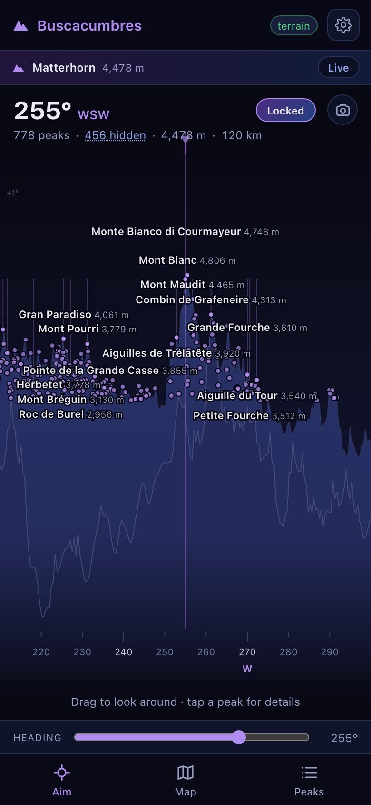
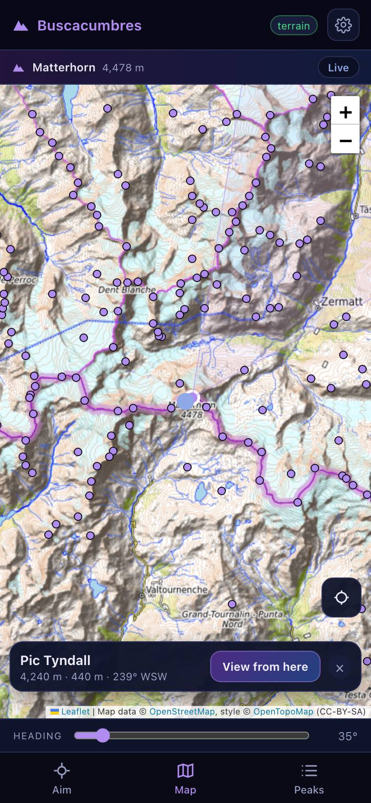

# Buscacumbres

A web app that tells you which mountain peaks you are looking at.
It is a static site: no backend, no accounts, no API keys, no developer account.
Install it from the browser like an app and it keeps working offline.

**Live:** https://wnklmx.github.io/mountain-peak-finder/



## What it does today (Phase 1)

- **Aim** – a 90° panorama of every peak around you, placed at its true bearing and
  elevation angle, with drag-to-look and compass lock. Labels never overlap.
- **Terrain skyline** – real DEM silhouettes drawn in distance bands, with **ridge
  occlusion**: peaks behind a ridge are hidden (tap the `hidden` count to reveal them as
  hollow rings).
- **Camera AR** – the rear camera with the skyline and labels on top, plus a calibration
  pill (`FOV`) that matches the overlay to the real lens.
- **Map** – terrain map with your position, a field-of-view wedge and every peak as a dot.
- **Peaks** – the list view: distance, bearing, elevation angle, turn-by-turn arrows,
  search and sorting, with a "behind ridge" tag for occluded peaks.
- **Stand on any peak** – tap a peak on the map (or in the list) and the panorama becomes
  the view from its summit, with the eye at the summit height and the map following. Tap a
  peak, hit **View from here**, and check the view from a mountain you know; **Live** goes
  back to your own position. The chosen viewpoint survives a reload.
- **Preset viewpoints** – Chamonix, Gornergrat, Jungfraujoch, Innsbruck, Berchtesgaden,
  Bolzano, Grindelwald, so you can try it anywhere (append `?demo=gornergrat` to the URL).
- **PWA** – installable, offline after the first load, auto-updating.

Tap a peak on the map for the view from its summit:



## Run it

```bash
npm install
npm run dev          # http://localhost:5173
npm run build        # production build in dist/
npm run preview
```

Camera and sensors need HTTPS (or `localhost`). To test on a phone over your LAN, use a
tunnel such as `cloudflared tunnel --url http://localhost:5173`.

To look out from a summit without going anywhere, add
`?stand=45.9763,7.6586,4478,Matterhorn` (latitude, longitude, eye altitude in metres, name)
or pick the peak on the map.

## Peak data

`public/data/peaks.geojson` is generated once and committed, so the deployed site has no
runtime dependencies.

```bash
npm run data:peaks-geonames   # default: GeoNames dumps, reliable, CC BY 4.0
npm run data:peaks            # OSM/Overpass, better names, but the public API is often busy
```

Both scripts read a bounding box from env vars and write `peaks.geojson` + `meta.json`:

```bash
WEST=6 SOUTH=45 EAST=10 NORTH=48 REGION_NAME="Switzerland" npm run data:peaks-geonames
```

The committed extract covers the Alps (`5.5 E – 16.5 E`, `43.5 N – 48.2 N`, 23k peaks,
3 MB). Outside it, the app still runs but coverage is thin — regenerate for your region.

## How the angles work

For a peak at elevation `h` and an eye at `h₀`, using local east/north offsets `x, y`:

```
d        = √(x² + y²)
bearing  = atan2(x, y)
angle    = atan( (h − h₀ − d²/(2R′)) / d ),   R′ = R / (1 − 0.13)
```

The `d²/(2R′)` term is earth curvature corrected for standard atmospheric refraction —
785 m over 100 km, so it cannot be skipped. Eye altitude comes from GPS (or the viewpoint:
a summit you stand on contributes its own height); a manual override lives in settings.

## How the skyline and occlusion work

A Web Worker ray-marches the horizon in 0.5° steps, using AWS Terrain Tiles (Terrarium
PNG heightmaps) at zoom levels 13 down to 9 as the distance grows. Rays are corrected for
the same curvature and refraction as the peaks, and each ray keeps the maximum angle it
sees over four distance cuts (3, 12, 40 and 120 km); the panorama fills those bands
separately to give the silhouette depth.

A peak is drawn only if its own elevation angle clears the ridge profile just in front of
it. The test skips the first 200 m and tolerates 14 m of canopy/DSM bias with a 0.3° floor,
so a treeline does not hide a summit. The eye is raised to the DEM ground plus 1.6 m when
GPS altitude is missing or low, which avoids the ground you stand on hiding everything.

The first terrain load downloads roughly **8 MB** of DEM tiles around you (a few seconds on
a phone); the service worker keeps them in the `dem-tiles` cache, so later visits are
instant. Walking about a kilometre reuses the same tiles; only the view direction changes.

## Deploy to GitHub Pages

The workflow in `.github/workflows/deploy.yml` builds and publishes on every push to `main`.
Once, in the repository:

1. **Settings → Pages → Source: GitHub Actions**
2. Push to `main`.

The Vite `base` is derived from `REPO_NAME` in the workflow, so the project-site path
(`/<repo>/`) works with no editing. For a user site or custom domain, set `REPO_NAME`
accordingly or drop the base override in `vite.config.ts`.

No Play Store, no `$25` fee, no identity verification. The URL is the distribution channel:
open it on Android Chrome and choose **Install app**.

## Project layout

```
src/
  geo.ts                    projection, bearing, elevation angle, formatting
  dem.ts                    Terrarium tiles, Mercator maths, distance bands
  data.ts                   GeoJSON loading, radius filter, ranking
  hooks/useGeolocation.ts   watchPosition wrapper
  hooks/useHeading.ts       compass + smoothing + iOS permission
  hooks/useTerrain.ts       worker lifecycle, progressive horizons
  worker/terrain.worker.ts  raymarch, tile cache, occlusion, skyline bands
  components/Panorama.tsx   the aim view (SVG, label collision, drag)
  components/CameraView.tsx camera stream + cover-crop aware overlay
  components/MapView.tsx    Leaflet map, FOV wedge, peak markers
  components/PeakList.tsx   searchable, sortable list
  components/SettingsSheet.tsx
scripts/
  fetch-peaks-geonames.mjs  GeoNames extractor (default)
  fetch-peaks.mjs           OSM/Overpass extractor
  make-icons.mjs            PNG icon generator (no image deps)
```

## Roadmap

- **Phase 1 – terrain skyline.** Done: DEM raymarch in a worker, banded silhouette, and a
  per-peak visibility test verified against an independent Python port (about 99% agreement
  at Chamonix; 3,260 hidden / 138 visible from Gornergrat).
- **Phase 2 – camera AR.** Done: rear camera background with the same overlay, cover-crop
  aware FOV and a calibration control.
- **Phase 3 – offline areas.** "Download this valley" caches DEM and peak tiles in IndexedDB
  so a trip with no signal still has a skyline.

## Attribution

- Peak data: [GeoNames](https://www.geonames.org/) country dumps, **CC BY 4.0**
  (or OpenStreetMap, **ODbL**, if you regenerate with `data:peaks`).
- Elevation: [AWS Open Data Terrain Tiles](https://registry.opendata.aws/terrain-tiles/)
  (Terrarium), originally from Mapzen.
- Map tiles: © OpenStreetMap contributors, style ©
  [OpenTopoMap](https://opentopomap.org) (CC-BY-SA).
- Elevation angles are estimates. Curvature and refraction are corrected; GPS altitude
  and summit elevations are not survey grade. Do not use for navigation.
